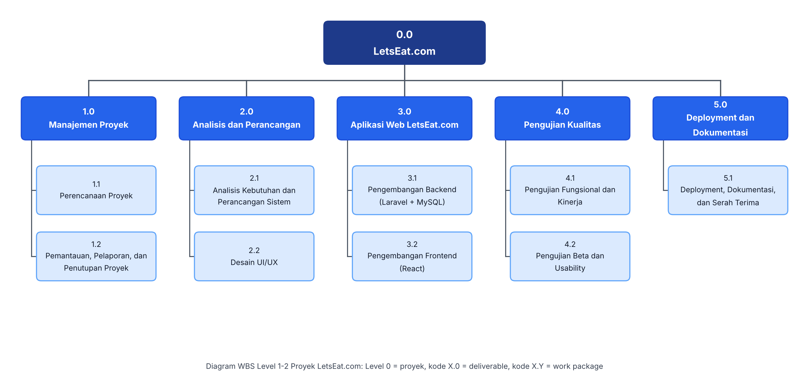

# Work Breakdown Structure (WBS)

## LetsOrder.com — Sistem Pemesanan dan Self-Pickup Digital untuk Kantin UPNVJ

## 1. Struktur WBS (Level 0–2)

Berikut merupakan visualisasi Work Breakdown Structure (WBS) proyek LetsOrder.com.

## 2. WBS Dictionary

WBS Dictionary memberikan penjelasan lebih terperinci mengenai setiap paket pekerjaan dalam struktur WBS, meliputi kode pekerjaan, nama paket pekerjaan, deskripsi, dan deliverable yang dihasilkan.

| Kode | Nama Paket Pekerjaan | Deskripsi | Deliverable |
|---|---|---|---|
| 1.1 | Perencanaan Proyek | Menetapkan ruang lingkup, jadwal, anggaran, peran tim, rencana komunikasi, dan identifikasi risiko proyek. | Project charter, jadwal proyek, pembagian tugas tim, dan register risiko. |
| 1.2 | Pemantauan, Pelaporan, dan Penutupan Proyek | Memantau kemajuan proyek, mencatat perubahan dan risiko, serta melakukan penutupan proyek secara formal. | Laporan kemajuan, log perubahan, dan laporan akhir proyek. |
| 2.1 | Analisis Kebutuhan dan Perancangan Sistem | Merumuskan kebutuhan fungsional dan nonfungsional, merancang arsitektur sistem, basis data MySQL berdasarkan ERD final, serta spesifikasi API. | Dokumen SRS, diagram UML dan ERD, rancangan arsitektur, serta spesifikasi API. |
| 2.2 | Desain UI/UX | Merancang alur pengguna, wireframe, dan prototipe responsif untuk Customer, Vendor, dan Administrator. | Wireframe, prototipe interaktif, dan panduan gaya visual. |
| 3.1 | Pengembangan Backend (Laravel + MySQL) | Mengembangkan backend dan basis data untuk autentikasi, pengelolaan tenant dan menu, keranjang, pemesanan, simulasi pembayaran, status pesanan, riwayat status, notifikasi, serta pengelolaan data. | Kode backend, REST API, implementasi basis data, dan dokumentasi backend. |
| 3.2 | Pengembangan Frontend (React) | Membangun antarmuka Customer, Vendor, dan Administrator serta mengintegrasikannya dengan API backend. | Aplikasi frontend berbasis React yang responsif dan terintegrasi. |
| 4.1 | Pengujian Fungsional dan Kinerja | Menguji fungsi sistem, integrasi antarmodul, kompatibilitas browser, dan kinerja aplikasi berdasarkan target kualitas yang ditetapkan. | Rencana pengujian, test case, laporan pengujian, log defect, dan hasil pengujian kinerja. |
| 4.2 | Pengujian Beta dan Usability | Melaksanakan uji coba bersama calon pengguna dan Vendor, mengumpulkan umpan balik, serta mengevaluasi kemudahan penggunaan sistem. | Laporan pengujian beta, rekapitulasi skor SUS, dan daftar perbaikan. |
| 5.1 | Deployment, Dokumentasi, dan Serah Terima | Menyiapkan konfigurasi deployment, memublikasikan aplikasi jika fasilitas tersedia, menyusun panduan penggunaan dan dokumentasi teknis, serta melaksanakan serah terima. | Aplikasi terpublikasi jika hosting tersedia, panduan pengguna, dokumentasi teknis, dan dokumen serah terima. |