# Database Design

## LetsOrder.com — Sistem Pemesanan dan Self-Pickup Digital untuk Kantin UPNVJ

| Informasi | Keterangan |
|---|---|
| Nama Proyek | LetsOrder.com |
| Jenis Dokumen | Database Design |
| Versi | 1.0 |
| Status Dokumen | Draft |
| Tanggal | 10 November 2026 |
| Database Management System | MySQL |
| Referensi | ERD Final LetsOrder.com |

---

# 1. Pendahuluan

## 1.1 Tujuan Dokumen

Dokumen Database Design menjelaskan rancangan basis data yang digunakan dalam pengembangan sistem LetsOrder.com. Dokumen ini menjadi acuan bagi tim pengembang dalam membangun struktur tabel, menentukan atribut, menetapkan primary key dan foreign key, serta mengelola hubungan antartabel.

Rancangan basis data disusun berdasarkan ERD final yang telah disepakati sehingga implementasi database harus mempertahankan struktur dan hubungan data tersebut.

## 1.2 Ruang Lingkup

Dokumen ini mencakup:

1. Teknologi dan prinsip perancangan database.
2. Daftar entitas dan atribut.
3. Primary key dan foreign key.
4. Hubungan antartabel.
5. Data dictionary.
6. Rekomendasi tipe data MySQL.
7. Ketentuan integritas dan pengelolaan data.

## 1.3 Teknologi Database

LetsOrder.com menggunakan MySQL sebagai sistem manajemen basis data relasional. MySQL digunakan untuk menyimpan data secara terstruktur serta menjaga hubungan antarentitas melalui primary key dan foreign key.

Backend Laravel berkomunikasi dengan database menggunakan mekanisme akses data yang disediakan oleh framework, termasuk Eloquent ORM dan Query Builder.

---

# 2. Gambaran Struktur Database

## 2.1 Daftar Entitas

Database LetsOrder.com terdiri atas 11 entitas utama.

| No. | Nama Entitas | Fungsi |
|---|---|---|
| 1 | USER | Menyimpan informasi akun dan peran pengguna. |
| 2 | TENANT | Menyimpan informasi tenant kantin. |
| 3 | KATEGORI | Menyimpan kategori makanan dan minuman. |
| 4 | MENU | Menyimpan informasi menu yang disediakan tenant. |
| 5 | KERANJANG | Menyimpan keranjang milik pengguna. |
| 6 | ITEM_KERANJANG | Menyimpan daftar item dalam keranjang. |
| 7 | PESANAN | Menyimpan informasi utama transaksi pemesanan. |
| 8 | DETAIL_PESANAN | Menyimpan rincian menu dalam pesanan. |
| 9 | PEMBAYARAN | Menyimpan informasi pembayaran simulasi. |
| 10 | RIWAYAT_STATUS | Menyimpan riwayat perubahan status pesanan. |
| 11 | NOTIFIKASI | Menyimpan pesan notifikasi untuk pengguna. |

## 2.2 Diagram ERD

Diagram berikut merupakan representasi hubungan antartabel berdasarkan struktur ERD final.

```mermaid
erDiagram
    USER {
        int id_user PK
        varchar username
        varchar nama
        varchar email
        varchar password
        varchar peran
    }

    TENANT {
        int id_tenant PK
        int id_user FK
        varchar nama_tenant
        text deskripsi
        varchar logo
        boolean status_buka
    }

    KATEGORI {
        int id_kategori PK
        varchar nama_kategori
        varchar icon
    }

    MENU {
        int id_menu PK
        int id_tenant FK
        int id_kategori FK
        varchar nama_menu
        text deskripsi
        varchar gambar
        decimal harga
        int estimasi_menit
        boolean status_tersedia
    }

    KERANJANG {
        int id_keranjang PK
        int id_user FK
    }

    ITEM_KERANJANG {
        int id_item_keranjang PK
        int id_keranjang FK
        int id_menu FK
        int jumlah
        text catatan
    }

    PESANAN {
        int id_pesanan PK
        int id_user FK
        int id_tenant FK
        varchar nomor_antrean
        varchar status_pesanan
        decimal total_harga
        text catatan
        datetime waktu_pesan
    }

    DETAIL_PESANAN {
        int id_detail PK
        int id_pesanan FK
        int id_menu FK
        int jumlah
        decimal subtotal
    }

    PEMBAYARAN {
        int id_pembayaran PK
        int id_pesanan FK
        varchar metode_pembayaran
        varchar kode_qris
        decimal total_bayar
        varchar status_verifikasi
        datetime batas_waktu
        datetime waktu_bayar
    }

    RIWAYAT_STATUS {
        int id_riwayat PK
        int id_pesanan FK
        varchar status
        datetime waktu
    }

    NOTIFIKASI {
        int id_notifikasi PK
        int id_user FK
        int id_pesanan FK
        text pesan
        boolean status_baca
    }

    USER ||--o{ TENANT : mengelola
    USER ||--o| KERANJANG : memiliki
    KERANJANG ||--o{ ITEM_KERANJANG : berisi
    MENU ||--o{ ITEM_KERANJANG : dipilih

    TENANT ||--o{ MENU : menyediakan
    KATEGORI ||--o{ MENU : mengelompokkan

    USER ||--o{ PESANAN : membuat
    TENANT ||--o{ PESANAN : menerima
    PESANAN ||--|{ DETAIL_PESANAN : memiliki
    MENU ||--o{ DETAIL_PESANAN : dipesan

    PESANAN ||--o{ PEMBAYARAN : memiliki
    PESANAN ||--o{ RIWAYAT_STATUS : mencatat
    USER ||--o{ NOTIFIKASI : menerima
    PESANAN ||--o{ NOTIFIKASI : berkaitan
```



**Catatan:** Diagram ini menggunakan notasi relasi berdasarkan struktur FK yang diketahui. Kardinalitas opsional atau wajib pada beberapa hubungan perlu dicocokkan kembali dengan diagram ERD final apabila terdapat ketentuan yang lebih spesifik.

---

# 3. Struktur Tabel dan Atribut

Bagian ini menjelaskan atribut setiap tabel beserta primary key, foreign key, dan rekomendasi tipe data MySQL.

## 3.1 Tabel USER

Tabel USER menyimpan informasi akun seluruh pengguna sistem, termasuk Customer, Vendor, dan Administrator.

| Atribut | Tipe Data Rekomendasi | Key | Keterangan |
|---|---|---|---|
| id_user | INT | PK | Identitas unik pengguna. |
| username | VARCHAR(50) | - | Username pengguna. |
| nama | VARCHAR(100) | - | Nama pengguna. |
| email | VARCHAR(100) | - | Alamat email pengguna. |
| password | VARCHAR(255) | - | Password yang telah di-hash. |
| peran | VARCHAR(30) | - | Peran pengguna dalam sistem. |

**Primary Key:** `id_user`

## 3.2 Tabel TENANT

Tabel TENANT menyimpan informasi tenant yang menyediakan makanan dan minuman di lingkungan kantin.

| Atribut | Tipe Data Rekomendasi | Key | Keterangan |
|---|---|---|---|
| id_tenant | INT | PK | Identitas unik tenant. |
| id_user | INT | FK | Referensi pengguna pengelola tenant. |
| nama_tenant | VARCHAR(100) | - | Nama tenant. |
| deskripsi | TEXT | - | Deskripsi tenant. |
| logo | VARCHAR(255) | - | Referensi lokasi atau nama file logo. |
| status_buka | BOOLEAN | - | Status buka atau tutup tenant. |

**Primary Key:** `id_tenant`

**Foreign Key:** `id_user` mengacu pada `USER.id_user`.

## 3.3 Tabel KATEGORI

Tabel KATEGORI menyimpan informasi kategori yang digunakan untuk mengelompokkan menu.

| Atribut | Tipe Data Rekomendasi | Key | Keterangan |
|---|---|---|---|
| id_kategori | INT | PK | Identitas unik kategori. |
| nama_kategori | VARCHAR(100) | - | Nama kategori menu. |
| icon | VARCHAR(255) | - | Referensi icon kategori. |

**Primary Key:** `id_kategori`

## 3.4 Tabel MENU

Tabel MENU menyimpan informasi makanan dan minuman yang ditawarkan oleh setiap tenant.

| Atribut | Tipe Data Rekomendasi | Key | Keterangan |
|---|---|---|---|
| id_menu | INT | PK | Identitas unik menu. |
| id_tenant | INT | FK | Referensi tenant pemilik menu. |
| id_kategori | INT | FK | Referensi kategori menu. |
| nama_menu | VARCHAR(100) | - | Nama makanan atau minuman. |
| deskripsi | TEXT | - | Deskripsi menu. |
| gambar | VARCHAR(255) | - | Referensi lokasi atau nama file gambar. |
| harga | DECIMAL(12,2) | - | Harga menu. |
| estimasi_menit | INT | - | Estimasi waktu persiapan menu dalam menit. |
| status_tersedia | BOOLEAN | - | Status ketersediaan menu. |

**Primary Key:** `id_menu`

**Foreign Key:**
- `id_tenant` mengacu pada `TENANT.id_tenant`.
- `id_kategori` mengacu pada `KATEGORI.id_kategori`.

## 3.5 Tabel KERANJANG

Tabel KERANJANG menyimpan informasi keranjang belanja milik pengguna.

| Atribut | Tipe Data Rekomendasi | Key | Keterangan |
|---|---|---|---|
| id_keranjang | INT | PK | Identitas unik keranjang. |
| id_user | INT | FK | Referensi pengguna pemilik keranjang. |

**Primary Key:** `id_keranjang`

**Foreign Key:** `id_user` mengacu pada `USER.id_user`.

## 3.6 Tabel ITEM_KERANJANG

Tabel ITEM_KERANJANG menyimpan daftar menu yang dimasukkan ke dalam keranjang.

| Atribut | Tipe Data Rekomendasi | Key | Keterangan |
|---|---|---|---|
| id_item_keranjang | INT | PK | Identitas unik item keranjang. |
| id_keranjang | INT | FK | Referensi keranjang. |
| id_menu | INT | FK | Referensi menu yang dipilih. |
| jumlah | INT | - | Jumlah menu yang dipilih. |
| catatan | TEXT | - | Catatan tambahan untuk item. |

**Primary Key:** `id_item_keranjang`

**Foreign Key:**
- `id_keranjang` mengacu pada `KERANJANG.id_keranjang`.
- `id_menu` mengacu pada `MENU.id_menu`.

## 3.7 Tabel PESANAN

Tabel PESANAN menyimpan informasi utama transaksi pemesanan yang dibuat oleh Customer.

| Atribut | Tipe Data Rekomendasi | Key | Keterangan |
|---|---|---|---|
| id_pesanan | INT | PK | Identitas unik pesanan. |
| id_user | INT | FK | Referensi Customer yang membuat pesanan. |
| id_tenant | INT | FK | Referensi tenant tujuan pesanan. |
| nomor_antrean | VARCHAR(30) | - | Nomor antrean pesanan. |
| status_pesanan | VARCHAR(30) | - | Status terkini pesanan. |
| total_harga | DECIMAL(12,2) | - | Total harga pesanan. |
| catatan | TEXT | - | Catatan untuk pesanan. |
| waktu_pesan | DATETIME | - | Waktu pesanan dibuat. |

**Primary Key:** `id_pesanan`

**Foreign Key:**
- `id_user` mengacu pada `USER.id_user`.
- `id_tenant` mengacu pada `TENANT.id_tenant`.

## 3.8 Tabel DETAIL_PESANAN

Tabel DETAIL_PESANAN menyimpan rincian menu yang terdapat dalam suatu pesanan.

| Atribut | Tipe Data Rekomendasi | Key | Keterangan |
|---|---|---|---|
| id_detail | INT | PK | Identitas unik detail pesanan. |
| id_pesanan | INT | FK | Referensi pesanan. |
| id_menu | INT | FK | Referensi menu yang dipesan. |
| jumlah | INT | - | Jumlah menu yang dipesan. |
| subtotal | DECIMAL(12,2) | - | Subtotal item pesanan. |

**Primary Key:** `id_detail`

**Foreign Key:**
- `id_pesanan` mengacu pada `PESANAN.id_pesanan`.
- `id_menu` mengacu pada `MENU.id_menu`.

## 3.9 Tabel PEMBAYARAN

Tabel PEMBAYARAN menyimpan informasi pembayaran yang dilakukan dalam proses simulasi pembayaran.

| Atribut | Tipe Data Rekomendasi | Key | Keterangan |
|---|---|---|---|
| id_pembayaran | INT | PK | Identitas unik pembayaran. |
| id_pesanan | INT | FK | Referensi pesanan yang dibayar. |
| metode_pembayaran | VARCHAR(30) | - | Metode pembayaran yang dipilih. |
| kode_qris | VARCHAR(255) | - | Kode atau referensi QRIS simulasi. |
| total_bayar | DECIMAL(12,2) | - | Total nominal pembayaran. |
| status_verifikasi | VARCHAR(30) | - | Status verifikasi pembayaran. |
| batas_waktu | DATETIME | - | Batas waktu pembayaran. |
| waktu_bayar | DATETIME | - | Waktu pembayaran tercatat. |

**Primary Key:** `id_pembayaran`

**Foreign Key:** `id_pesanan` mengacu pada `PESANAN.id_pesanan`.

## 3.10 Tabel RIWAYAT_STATUS

Tabel RIWAYAT_STATUS digunakan untuk menyimpan perubahan status pesanan berdasarkan waktu terjadinya perubahan.

| Atribut | Tipe Data Rekomendasi | Key | Keterangan |
|---|---|---|---|
| id_riwayat | INT | PK | Identitas unik riwayat status. |
| id_pesanan | INT | FK | Referensi pesanan. |
| status | VARCHAR(30) | - | Status pesanan yang dicatat. |
| waktu | DATETIME | - | Waktu perubahan status. |

**Primary Key:** `id_riwayat`

**Foreign Key:** `id_pesanan` mengacu pada `PESANAN.id_pesanan`.

## 3.11 Tabel NOTIFIKASI

Tabel NOTIFIKASI menyimpan pesan pemberitahuan yang berkaitan dengan aktivitas pesanan dan pengguna.

| Atribut | Tipe Data Rekomendasi | Key | Keterangan |
|---|---|---|---|
| id_notifikasi | INT | PK | Identitas unik notifikasi. |
| id_user | INT | FK | Referensi pengguna penerima notifikasi. |
| id_pesanan | INT | FK | Referensi pesanan terkait notifikasi. |
| pesan | TEXT | - | Isi pesan notifikasi. |
| status_baca | BOOLEAN | - | Status sudah atau belum dibaca. |

**Primary Key:** `id_notifikasi`

**Foreign Key:**
- `id_user` mengacu pada `USER.id_user`.
- `id_pesanan` mengacu pada `PESANAN.id_pesanan`.

---

# 4. Hubungan Antarentitas

Bagian ini menjelaskan hubungan antara entitas berdasarkan foreign key yang telah ditetapkan.

| No. | Entitas Pertama | Entitas Kedua | Hubungan | Keterangan |
|---|---|---|---|---|
| 1 | USER | TENANT | One-to-Many | Satu pengguna dapat menjadi pengelola tenant sesuai relasi ERD. |
| 2 | USER | KERANJANG | One-to-One (opsional pada sisi keranjang) | Keranjang dimiliki oleh satu pengguna. |
| 3 | KERANJANG | ITEM_KERANJANG | One-to-Many | Satu keranjang dapat berisi beberapa item. |
| 4 | MENU | ITEM_KERANJANG | One-to-Many | Satu menu dapat muncul pada beberapa item keranjang. |
| 5 | TENANT | MENU | One-to-Many | Satu tenant dapat menyediakan beberapa menu. |
| 6 | KATEGORI | MENU | One-to-Many | Satu kategori dapat digunakan oleh beberapa menu. |
| 7 | USER | PESANAN | One-to-Many | Satu pengguna dapat membuat beberapa pesanan. |
| 8 | TENANT | PESANAN | One-to-Many | Satu tenant dapat menerima beberapa pesanan. |
| 9 | PESANAN | DETAIL_PESANAN | One-to-Many | Satu pesanan memiliki rincian item. |
| 10 | MENU | DETAIL_PESANAN | One-to-Many | Satu menu dapat muncul dalam beberapa detail pesanan. |
| 11 | PESANAN | PEMBAYARAN | One-to-Many (berdasarkan FK) | Data pembayaran dikaitkan dengan pesanan. |
| 12 | PESANAN | RIWAYAT_STATUS | One-to-Many | Satu pesanan dapat memiliki beberapa catatan perubahan status. |
| 13 | USER | NOTIFIKASI | One-to-Many | Satu pengguna dapat menerima beberapa notifikasi. |
| 14 | PESANAN | NOTIFIKASI | One-to-Many | Satu pesanan dapat berkaitan dengan beberapa notifikasi. |

**Catatan:** Kardinalitas pada tabel mengikuti interpretasi relasi berdasarkan FK. Batasan unik dan kewajiban relasi hanya boleh ditetapkan sesuai ERD final dan aturan bisnis yang telah disepakati.

---

# 5. Data Dictionary

Data dictionary merupakan dokumentasi terstruktur mengenai atribut yang digunakan dalam database. Bagian ini merangkum seluruh atribut agar pengembang dapat mengidentifikasi fungsi dan tipe data setiap kolom.

| Tabel | Atribut | Tipe Data | Key |
|---|---|---|---|
| USER | id_user | INT | PK |
| USER | username | VARCHAR(50) | - |
| USER | nama | VARCHAR(100) | - |
| USER | email | VARCHAR(100) | - |
| USER | password | VARCHAR(255) | - |
| USER | peran | VARCHAR(30) | - |
| TENANT | id_tenant | INT | PK |
| TENANT | id_user | INT | FK |
| TENANT | nama_tenant | VARCHAR(100) | - |
| TENANT | deskripsi | TEXT | - |
| TENANT | logo | VARCHAR(255) | - |
| TENANT | status_buka | BOOLEAN | - |
| KATEGORI | id_kategori | INT | PK |
| KATEGORI | nama_kategori | VARCHAR(100) | - |
| KATEGORI | icon | VARCHAR(255) | - |
| MENU | id_menu | INT | PK |
| MENU | id_tenant | INT | FK |
| MENU | id_kategori | INT | FK |
| MENU | nama_menu | VARCHAR(100) | - |
| MENU | deskripsi | TEXT | - |
| MENU | gambar | VARCHAR(255) | - |
| MENU | harga | DECIMAL(12,2) | - |
| MENU | estimasi_menit | INT | - |
| MENU | status_tersedia | BOOLEAN | - |
| KERANJANG | id_keranjang | INT | PK |
| KERANJANG | id_user | INT | FK |
| ITEM_KERANJANG | id_item_keranjang | INT | PK |
| ITEM_KERANJANG | id_keranjang | INT | FK |
| ITEM_KERANJANG | id_menu | INT | FK |
| ITEM_KERANJANG | jumlah | INT | - |
| ITEM_KERANJANG | catatan | TEXT | - |
| PESANAN | id_pesanan | INT | PK |
| PESANAN | id_user | INT | FK |
| PESANAN | id_tenant | INT | FK |
| PESANAN | nomor_antrean | VARCHAR(30) | - |
| PESANAN | status_pesanan | VARCHAR(30) | - |
| PESANAN | total_harga | DECIMAL(12,2) | - |
| PESANAN | catatan | TEXT | - |
| PESANAN | waktu_pesan | DATETIME | - |
| DETAIL_PESANAN | id_detail | INT | PK |
| DETAIL_PESANAN | id_pesanan | INT | FK |
| DETAIL_PESANAN | id_menu | INT | FK |
| DETAIL_PESANAN | jumlah | INT | - |
| DETAIL_PESANAN | subtotal | DECIMAL(12,2) | - |
| PEMBAYARAN | id_pembayaran | INT | PK |
| PEMBAYARAN | id_pesanan | INT | FK |
| PEMBAYARAN | metode_pembayaran | VARCHAR(30) | - |
| PEMBAYARAN | kode_qris | VARCHAR(255) | - |
| PEMBAYARAN | total_bayar | DECIMAL(12,2) | - |
| PEMBAYARAN | status_verifikasi | VARCHAR(30) | - |
| PEMBAYARAN | batas_waktu | DATETIME | - |
| PEMBAYARAN | waktu_bayar | DATETIME | - |
| RIWAYAT_STATUS | id_riwayat | INT | PK |
| RIWAYAT_STATUS | id_pesanan | INT | FK |
| RIWAYAT_STATUS | status | VARCHAR(30) | - |
| RIWAYAT_STATUS | waktu | DATETIME | - |
| NOTIFIKASI | id_notifikasi | INT | PK |
| NOTIFIKASI | id_user | INT | FK |
| NOTIFIKASI | id_pesanan | INT | FK |
| NOTIFIKASI | pesan | TEXT | - |
| NOTIFIKASI | status_baca | BOOLEAN | - |

---

# 6. Ketentuan Integritas Database

## 6.1 Primary Key

Setiap tabel harus memiliki primary key yang berfungsi sebagai identitas unik setiap record. Primary key tidak boleh memiliki nilai duplikat atau NULL.

## 6.2 Foreign Key

Foreign key digunakan untuk menghubungkan data antarentitas dan menjaga integritas referensial.

Contohnya:

- `TENANT.id_user` mengacu pada `USER.id_user`.
- `MENU.id_tenant` mengacu pada `TENANT.id_tenant`.
- `PESANAN.id_user` mengacu pada `USER.id_user`.
- `DETAIL_PESANAN.id_pesanan` mengacu pada `PESANAN.id_pesanan`.

## 6.3 Konsistensi Data

Ketentuan konsistensi data yang perlu diterapkan meliputi:

1. Setiap pesanan harus memiliki pengguna dan tenant yang valid.
2. Setiap detail pesanan harus merujuk pada pesanan dan menu yang valid.
3. Setiap item keranjang harus merujuk pada keranjang dan menu yang valid.
4. Setiap pembayaran harus terkait dengan pesanan yang valid.
5. Setiap riwayat status harus terkait dengan pesanan yang valid.
6. Setiap notifikasi harus terkait dengan pengguna dan pesanan sesuai struktur ERD.
7. Nilai jumlah dan nominal harus divalidasi sebelum disimpan.

## 6.4 Transaksi Database

Operasi yang melibatkan beberapa tabel harus mempertimbangkan penggunaan database transaction.

Contohnya, saat Customer membuat pesanan, proses penyimpanan data PESANAN dan DETAIL_PESANAN perlu dijaga konsistensinya. Apabila salah satu proses gagal, transaksi perlu ditangani agar tidak menghasilkan data pesanan yang tidak lengkap.

---

# 7. Ketentuan Implementasi Database

## 7.1 Penamaan Tabel dan Kolom

Penamaan tabel dan kolom harus mengikuti ERD final. Nama tabel menggunakan nama entitas yang telah ditetapkan, sedangkan nama kolom mempertahankan nama atribut pada ERD.

## 7.2 Konfigurasi Database

Konfigurasi koneksi MySQL dilakukan melalui file lingkungan backend Laravel.

Contoh konfigurasi:

```env
DB_CONNECTION=mysql
DB_HOST=127.0.0.1
DB_PORT=3306
DB_DATABASE=letsorder
DB_USERNAME=root
DB_PASSWORD=
```

Nilai konfigurasi tersebut merupakan contoh untuk lingkungan pengembangan lokal. Kredensial produksi harus diatur secara terpisah dan tidak boleh dimasukkan ke repository publik.

## 7.3 Migration dan Seeding

Laravel Migration digunakan untuk mendefinisikan struktur tabel berdasarkan ERD final. Seeder dapat digunakan untuk memasukkan data awal yang diperlukan selama pengembangan dan pengujian.

Implementasi migration harus memperhatikan:

1. Kesamaan nama tabel dan kolom dengan ERD.
2. Penentuan primary key dan foreign key.
3. Kesesuaian tipe data.
4. Urutan pembuatan tabel berdasarkan dependensi relasi.
5. Integritas data saat proses migration dijalankan.

---

# 8. Batasan Rancangan Database

Rancangan database memiliki batasan sebagai berikut:

1. Database hanya terdiri atas 11 entitas yang telah ditetapkan.
2. Tidak diperbolehkan menambahkan entitas baru tanpa persetujuan perubahan ERD.
3. Tidak diperbolehkan menambahkan atribut baru yang tidak tercantum pada ERD final.
4. Satu pesanan hanya merujuk pada satu tenant melalui `id_tenant`.
5. Identifikasi pengambilan pesanan menggunakan `nomor_antrean`.
6. Pembayaran hanya mendukung kebutuhan simulasi.
7. Tidak terdapat penyimpanan data promo, diskon, rating, ulasan, favorit, maupun rekomendasi.
8. Tabel DETAIL_PESANAN tidak memiliki atribut `harga_satuan`.
9. Tidak terdapat atribut status aktif akun pengguna pada tabel USER.
10. Status buka pada TENANT digunakan untuk menunjukkan kondisi buka atau tutup tenant.

---

# 9. Penutup

Rancangan database LetsOrder.com terdiri atas 11 entitas yang saling berhubungan untuk mendukung proses pengelolaan pengguna, tenant, menu, keranjang, pesanan, pembayaran, riwayat status, dan notifikasi.

Dokumen ini menjadi acuan implementasi database MySQL melalui Laravel Migration dan Eloquent ORM. Seluruh implementasi harus mempertahankan struktur ERD final agar konsistensi antara kebutuhan sistem, rancangan database, dan implementasi aplikasi tetap terjaga.