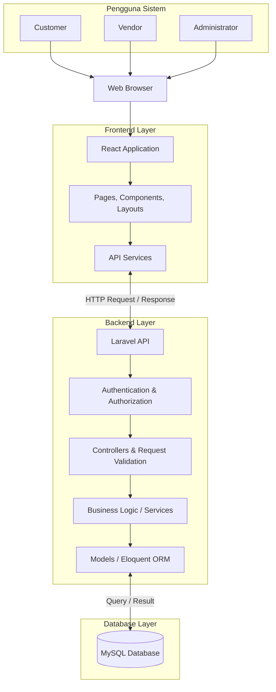
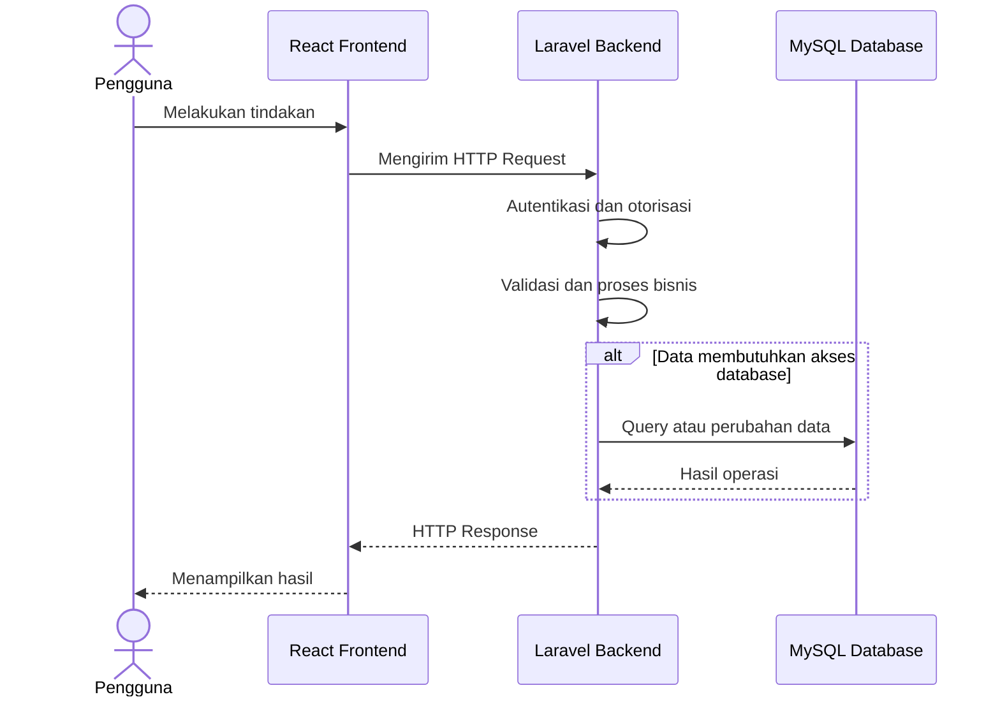
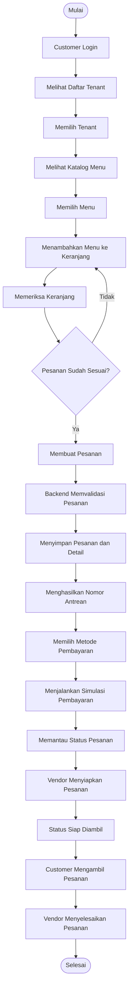

# System Architecture

## LetsOrder.com — Sistem Pemesanan dan Self-Pickup Digital untuk Kantin UPNVJ

| Informasi | Keterangan |
|---|---|
| Nama Proyek | LetsOrder.com |
| Jenis Dokumen | System Architecture |
| Versi | 1.0 |
| Status Dokumen | Draft |
| Tanggal | 10 November 2026 |
| Frontend | React |
| Backend | Laravel |
| Database | MySQL |

---

# 1. Pendahuluan

## 1.1 Tujuan Dokumen

Dokumen System Architecture menjelaskan rancangan arsitektur teknis sistem LetsOrder.com sebagai dasar dalam proses pengembangan perangkat lunak. Dokumen ini memberikan gambaran mengenai komponen utama sistem, hubungan antarbagian, aliran komunikasi, serta tanggung jawab setiap komponen.

Arsitektur dirancang untuk mendukung proses pemesanan makanan dan minuman secara digital dengan mekanisme self-pickup di lingkungan Kantin UPNVJ.

## 1.2 Ruang Lingkup

Pembahasan dalam dokumen ini mencakup:

1. Gambaran umum arsitektur sistem.
2. Arsitektur frontend, backend, dan database.
3. Hubungan komunikasi antarkomponen.
4. Aliran data dan proses pemesanan.
5. Pembagian tanggung jawab berdasarkan peran pengguna.
6. Keamanan dan pertimbangan kualitas sistem.
7. Batasan arsitektur berdasarkan teknologi dan ERD final.

## 1.3 Prinsip Perancangan

Arsitektur LetsOrder.com menggunakan beberapa prinsip berikut:

- **Separation of Concerns:** frontend, backend, dan database memiliki tanggung jawab yang berbeda.
- **Client-Server Architecture:** pengguna mengakses sistem melalui frontend yang berkomunikasi dengan backend.
- **API-Based Communication:** pertukaran data antara frontend dan backend dilakukan melalui API.
- **Role-Based Access Control:** akses fungsi sistem dibatasi berdasarkan peran Customer, Vendor, dan Administrator.
- **Database Consistency:** penyimpanan dan pengelolaan data mengikuti struktur ERD final.
- **Maintainability:** struktur aplikasi disusun agar lebih mudah dikembangkan, diperbaiki, dan dipelihara.

---

# 2. Gambaran Umum Arsitektur

LetsOrder.com menggunakan pendekatan arsitektur **Client-Server** yang terdiri atas tiga komponen utama, yaitu frontend, backend, dan database.

Frontend bertanggung jawab menyediakan antarmuka bagi pengguna. Backend menangani pemrosesan permintaan, validasi, autentikasi, otorisasi, dan aturan bisnis. Database digunakan untuk menyimpan serta mengelola data yang dibutuhkan oleh sistem.

Ketiga komponen tersebut saling terhubung untuk mendukung aktivitas pemesanan hingga pengambilan pesanan oleh Customer.

## 2.1 Komponen Utama Sistem

| Komponen | Teknologi | Tanggung Jawab |
|---|---|---|
| Frontend | React | Menampilkan antarmuka, menerima input pengguna, dan berkomunikasi dengan backend. |
| Backend | Laravel | Menangani API, autentikasi, otorisasi, validasi, aturan bisnis, dan pengelolaan data. |
| Database | MySQL | Menyimpan data pengguna, tenant, menu, keranjang, pesanan, pembayaran, riwayat status, dan notifikasi. |
| Web Browser | Browser yang didukung | Menjadi media akses pengguna terhadap aplikasi. |

## 2.2 Diagram Arsitektur Sistem

Diagram berikut menggambarkan hubungan antara pengguna, frontend, backend, dan database.



## 2.3 Penjelasan Lapisan Arsitektur

### A. Presentation Layer

Presentation Layer merupakan bagian yang berinteraksi langsung dengan pengguna melalui aplikasi React.

Tanggung jawabnya meliputi:

1. Menampilkan halaman sesuai peran pengguna.
2. Menyediakan formulir untuk memasukkan data.
3. Menampilkan katalog tenant dan menu.
4. Menyediakan tampilan keranjang dan pemesanan.
5. Menampilkan status pesanan dan informasi pembayaran.
6. Menampilkan dashboard pengelolaan bagi Vendor dan Administrator.

### B. Application Layer

Application Layer berada pada sisi backend menggunakan Laravel. Lapisan ini menangani proses aplikasi dan menjadi penghubung antara frontend dengan database.

Tanggung jawabnya meliputi:

1. Menerima dan memproses permintaan API.
2. Melakukan autentikasi dan otorisasi pengguna.
3. Memvalidasi data yang dikirimkan.
4. Menjalankan aturan bisnis sistem.
5. Mengelola proses pemesanan dan pembayaran simulasi.
6. Mengelola perubahan status pesanan.
7. Mengambil dan menyimpan data melalui model.

### C. Data Layer

Data Layer menggunakan MySQL sebagai sistem manajemen basis data relasional.

Tanggung jawabnya meliputi:

1. Menyimpan informasi pengguna dan tenant.
2. Menyimpan data kategori dan menu.
3. Menyimpan data keranjang dan item keranjang.
4. Menyimpan data pesanan dan detail pesanan.
5. Menyimpan informasi pembayaran.
6. Menyimpan riwayat perubahan status pesanan.
7. Menyimpan notifikasi pengguna.

---

# 3. Arsitektur Frontend

## 3.1 Teknologi Frontend

Frontend dikembangkan menggunakan React untuk membangun antarmuka aplikasi berbasis web. React memungkinkan antarmuka dibagi menjadi komponen-komponen yang dapat digunakan kembali.

Aplikasi frontend menyediakan tampilan berdasarkan tiga kategori pengguna, yaitu Customer, Vendor, dan Administrator.

## 3.2 Struktur Komponen Frontend

Struktur direktori frontend mengikuti susunan yang telah ditetapkan pada repository.

```text
frontend/
├── public/
│   ├── images/
│   ├── icons/
│   └── favicon.ico
│
├── src/
│   ├── assets/
│   │   ├── images/
│   │   ├── icons/
│   │   └── styles/
│   │
│   ├── components/
│   │   ├── common/
│   │   ├── layout/
│   │   └── ui/
│   │
│   ├── pages/
│   │   ├── customer/
│   │   ├── vendor/
│   │   └── administrator/
│   │
│   ├── layouts/
│   ├── routes/
│   ├── services/
│   ├── hooks/
│   ├── contexts/
│   ├── utils/
│   ├── constants/
│   ├── styles/
│   ├── App.jsx
│   └── main.jsx
│
├── tests/
├── .env.example
├── package.json
└── vite.config.js
```

## 3.3 Tanggung Jawab Direktori

| Direktori | Tanggung Jawab |
|---|---|
| `components/common/` | Menyimpan komponen umum yang dapat digunakan pada berbagai halaman. |
| `components/layout/` | Menyimpan komponen struktur tampilan seperti navigasi dan sidebar. |
| `components/ui/` | Menyimpan komponen antarmuka seperti tombol, input, dan modal. |
| `pages/customer/` | Menyimpan halaman untuk aktivitas Customer. |
| `pages/vendor/` | Menyimpan halaman pengelolaan tenant dan pesanan Vendor. |
| `pages/administrator/` | Menyimpan halaman pengelolaan data oleh Administrator. |
| `layouts/` | Mengatur kerangka tampilan berdasarkan kebutuhan halaman. |
| `routes/` | Mengatur navigasi dan pembatasan akses halaman. |
| `services/` | Menangani komunikasi frontend dengan API backend. |
| `hooks/` | Menyimpan custom React hooks. |
| `contexts/` | Mengelola state global yang diperlukan aplikasi. |
| `utils/` | Menyimpan fungsi bantuan yang digunakan oleh aplikasi. |
| `constants/` | Menyimpan nilai atau konfigurasi konstan. |
| `styles/` | Menyimpan stylesheet aplikasi. |

## 3.4 Pembagian Antarmuka Berdasarkan Peran

| Peran | Area Antarmuka | Fungsi Utama |
|---|---|---|
| Customer | Customer Pages | Melihat tenant dan menu, mengelola keranjang, membuat pesanan, melakukan simulasi pembayaran, serta memantau pesanan. |
| Vendor | Vendor Pages | Mengelola informasi tenant, mengelola menu, melihat pesanan masuk, dan memperbarui status pesanan. |
| Administrator | Administrator Pages | Melihat dan mengelola data pengguna serta tenant. |

---

# 4. Arsitektur Backend

## 4.1 Teknologi Backend

Backend dikembangkan menggunakan Laravel sebagai framework PHP. Laravel digunakan untuk menangani logika aplikasi, menyediakan API, mengelola autentikasi, melakukan validasi, dan berkomunikasi dengan database MySQL.

Backend menjadi pusat pemrosesan sehingga aturan bisnis dan validasi tidak hanya bergantung pada antarmuka frontend.

## 4.2 Struktur Komponen Backend

Struktur backend mengikuti susunan direktori yang telah ditetapkan pada repository.

```text
backend/
├── app/
│   ├── Http/
│   │   ├── Controllers/
│   │   │   ├── Auth/
│   │   │   ├── Customer/
│   │   │   ├── Vendor/
│   │   │   └── Administrator/
│   │   ├── Middleware/
│   │   ├── Requests/
│   │   └── Resources/
│   │
│   ├── Models/
│   ├── Services/
│   ├── Repositories/
│   ├── Exceptions/
│   └── Providers/
│
├── bootstrap/
├── config/
├── database/
│   ├── factories/
│   ├── migrations/
│   └── seeders/
│
├── public/
├── resources/
├── routes/
│   ├── api.php
│   └── web.php
│
├── storage/
├── tests/
│   ├── Feature/
│   └── Unit/
│
├── .env.example
├── artisan
├── composer.json
└── composer.lock
```

## 4.3 Tanggung Jawab Komponen Backend

| Komponen | Tanggung Jawab |
|---|---|
| Controllers | Menerima permintaan dan mengatur respons API. |
| Middleware | Memeriksa autentikasi dan membatasi akses berdasarkan peran. |
| Requests | Melakukan validasi data yang diterima dari pengguna. |
| Resources | Mengatur format data yang dikirimkan melalui API. |
| Models | Merepresentasikan entitas dan mengelola interaksi dengan database. |
| Services | Menjalankan aturan bisnis dan proses aplikasi. |
| Repositories | Mengelompokkan operasi akses data apabila pola repository digunakan. |
| Exceptions | Menangani kondisi kesalahan aplikasi. |
| Providers | Mengatur kebutuhan layanan dan konfigurasi aplikasi Laravel. |

## 4.4 Pembagian Modul Backend

| Modul | Fungsi Utama |
|---|---|
| Authentication | Registrasi, login, validasi kredensial, dan identifikasi peran pengguna. |
| Tenant Management | Pengelolaan informasi tenant. |
| Menu Management | Pengelolaan kategori dan informasi menu sesuai kewenangan yang ditetapkan. |
| Cart Management | Pengelolaan keranjang dan item keranjang. |
| Order Management | Pembuatan, penyimpanan, dan pengelolaan pesanan. |
| Payment Management | Pengelolaan data pembayaran dan simulasi verifikasi. |
| Order Tracking | Pengelolaan status dan riwayat status pesanan. |
| Notification Management | Pengelolaan pesan notifikasi dan status bacanya. |
| User Management | Pengelolaan data pengguna oleh Administrator. |

Pembagian modul tersebut merupakan pengelompokan tanggung jawab aplikasi, bukan penambahan entitas baru pada database.

---

# 5. Arsitektur Database

## 5.1 Teknologi Database

LetsOrder.com menggunakan MySQL sebagai sistem manajemen basis data relasional. MySQL dipilih untuk menyimpan data secara terstruktur dan mendukung hubungan antartabel melalui primary key dan foreign key.

Pengelolaan struktur database dilakukan dengan memperhatikan ERD final yang telah disepakati.

## 5.2 Entitas Database

Database LetsOrder.com terdiri atas 11 entitas berikut:

| No. | Entitas | Fungsi |
|---|---|---|
| 1 | USER | Menyimpan informasi akun dan peran pengguna. |
| 2 | TENANT | Menyimpan informasi tenant kantin. |
| 3 | KATEGORI | Menyimpan kategori menu. |
| 4 | MENU | Menyimpan informasi makanan dan minuman. |
| 5 | KERANJANG | Menyimpan data keranjang milik pengguna. |
| 6 | ITEM_KERANJANG | Menyimpan item yang dimasukkan ke keranjang. |
| 7 | PESANAN | Menyimpan informasi utama pesanan. |
| 8 | DETAIL_PESANAN | Menyimpan rincian item dalam pesanan. |
| 9 | PEMBAYARAN | Menyimpan informasi pembayaran simulasi. |
| 10 | RIWAYAT_STATUS | Menyimpan riwayat perubahan status pesanan. |
| 11 | NOTIFIKASI | Menyimpan pesan notifikasi untuk pengguna. |

## 5.3 Ketentuan Pengelolaan Data

1. Setiap entitas harus mengikuti atribut dan hubungan yang telah ditentukan dalam ERD final.
2. Primary key digunakan sebagai identitas setiap record.
3. Foreign key digunakan untuk menjaga hubungan antartabel.
4. Operasi penyimpanan dan perubahan data harus memperhatikan integritas referensial.
5. Proses pembuatan pesanan harus menjaga konsistensi antara data PESANAN dan DETAIL_PESANAN.
6. Informasi pembayaran disimpan pada entitas PEMBAYARAN.
7. Perubahan status pesanan dicatat melalui RIWAYAT_STATUS.
8. Notifikasi dikaitkan dengan pengguna dan pesanan sesuai struktur ERD.
9. Tidak diperbolehkan menambahkan entitas, atribut, atau relasi baru tanpa perubahan ERD yang disetujui.

---

# 6. Arsitektur Komunikasi dan Aliran Data

## 6.1 Komunikasi Frontend dan Backend

Frontend React berkomunikasi dengan backend Laravel melalui API menggunakan protokol HTTP. Pada lingkungan deployment yang mendukungnya, komunikasi menggunakan HTTPS untuk melindungi pertukaran data.

Secara umum, proses komunikasi berlangsung sebagai berikut:

1. Pengguna melakukan tindakan melalui antarmuka React.
2. Frontend mengirimkan permintaan ke endpoint API Laravel.
3. Backend memeriksa autentikasi dan otorisasi.
4. Backend melakukan validasi terhadap data permintaan.
5. Backend menjalankan logika aplikasi.
6. Backend mengakses database MySQL apabila diperlukan.
7. Database mengembalikan hasil operasi.
8. Backend mengirimkan respons kepada frontend.
9. Frontend menampilkan hasil kepada pengguna.

## 6.2 Diagram Aliran Komunikasi



## 6.3 Format Pertukaran Data

Pertukaran data antara frontend dan backend menggunakan format JSON untuk kebutuhan API.

Contoh struktur respons umum:

```json
{
  "success": true,
  "message": "Permintaan berhasil diproses",
  "data": {}
}
```

Struktur tersebut merupakan contoh format respons. Implementasi akhir perlu menggunakan format yang konsisten pada seluruh endpoint API.

## 6.4 Penanganan Respons dan Kesalahan

Backend harus memberikan respons yang sesuai dengan hasil pemrosesan permintaan.

| Kondisi | HTTP Status | Keterangan |
|---|---:|---|
| Permintaan berhasil | 200 OK | Data berhasil diproses atau ditampilkan. |
| Data berhasil dibuat | 201 Created | Record baru berhasil dibuat. |
| Permintaan tidak valid | 422 Unprocessable Content | Data tidak memenuhi validasi. |
| Belum terautentikasi | 401 Unauthorized | Pengguna belum memiliki autentikasi yang valid. |
| Tidak memiliki izin | 403 Forbidden | Pengguna tidak memiliki hak akses. |
| Data tidak ditemukan | 404 Not Found | Sumber daya yang diminta tidak ditemukan. |
| Kesalahan server | 500 Internal Server Error | Terjadi kesalahan pada sisi backend. |

---

# 7. Aliran Proses Utama Sistem

## 7.1 Aliran Proses Pemesanan

Proses pemesanan merupakan alur utama dalam LetsOrder.com. Customer memilih tenant dan menu, memasukkan item ke keranjang, kemudian membuat pesanan untuk diproses oleh Vendor.



## 7.2 Aliran Proses Pengelolaan Menu

1. Vendor masuk ke sistem.
2. Vendor membuka halaman pengelolaan menu.
3. Backend memeriksa kewenangan Vendor terhadap tenant.
4. Vendor menambahkan, mengubah, atau menghapus informasi menu.
5. Backend memvalidasi data yang diterima.
6. Perubahan disimpan ke database MySQL.
7. Frontend menampilkan informasi menu terbaru.

## 7.3 Aliran Proses Pembayaran Simulasi

1. Customer memilih metode pembayaran yang tersedia.
2. Sistem menampilkan informasi pembayaran.
3. Apabila Customer memilih QRIS, sistem menampilkan kode QRIS simulasi.
4. Sistem menjalankan proses verifikasi sesuai mekanisme simulasi yang diimplementasikan.
5. Status verifikasi pembayaran diperbarui.
6. Informasi pembayaran ditampilkan kepada Customer dan pihak yang berwenang.

**Catatan:** Sistem tidak terhubung dengan payment gateway atau layanan pembayaran eksternal. Proses pembayaran hanya digunakan untuk simulasi alur sistem.

## 7.4 Aliran Proses Self-Pickup

1. Vendor memproses pesanan yang masuk.
2. Vendor memperbarui status pesanan sesuai perkembangan proses.
3. Ketika pesanan siap, status diperbarui menjadi siap diambil.
4. Customer melihat informasi status dan nomor antrean.
5. Customer mengambil pesanan langsung di tenant.
6. Vendor memperbarui status pesanan menjadi selesai.

---

# 8. Keamanan Arsitektur

Keamanan diterapkan pada setiap lapisan sistem untuk menjaga data dan membatasi akses terhadap fungsi aplikasi.

## 8.1 Autentikasi

Sistem harus memastikan bahwa pengguna telah melakukan login sebelum mengakses fungsi yang memerlukan akun.

Password pengguna harus disimpan menggunakan metode hashing yang aman, bukan dalam bentuk teks biasa.

## 8.2 Otorisasi

Pembatasan akses dilakukan berdasarkan peran pengguna.

| Peran | Hak Akses Utama |
|---|---|
| Customer | Mengelola keranjang, membuat pesanan, melihat pembayaran, dan memantau pesanan miliknya. |
| Vendor | Mengelola informasi tenant dan menu serta memproses pesanan tenant yang dikelolanya. |
| Administrator | Melihat dan mengelola data pengguna serta tenant sesuai kewenangannya. |

Pemeriksaan hak akses harus dilakukan pada backend, bukan hanya dengan menyembunyikan halaman atau tombol pada frontend.

## 8.3 Validasi Data

Backend harus melakukan validasi terhadap data yang diterima, termasuk data akun, menu, keranjang, pesanan, dan pembayaran.

Validasi diperlukan untuk mengurangi kesalahan input dan mencegah perubahan data yang tidak sesuai aturan sistem.

## 8.4 Perlindungan Komunikasi

Apabila sistem telah di-deploy pada lingkungan yang mendukungnya, komunikasi antara frontend dan backend harus menggunakan HTTPS.

Konfigurasi rahasia seperti kredensial database dan kunci aplikasi disimpan dalam file lingkungan dan tidak dimasukkan ke repository publik.

---

# 9. Pertimbangan Kualitas Arsitektur

Perancangan arsitektur memperhatikan karakteristik kualitas perangkat lunak berdasarkan ISO/IEC 25010.

| Aspek Kualitas | Penerapan pada LetsOrder.com |
|---|---|
| Performance Efficiency | Mengoptimalkan pemuatan halaman, pemrosesan API, dan pengambilan data. Target waktu pemuatan halaman kurang dari 2 detik. |
| Security | Menerapkan autentikasi, otorisasi berbasis peran, hashing password, dan validasi input. |
| Usability | Menyediakan antarmuka yang mudah dipahami dan navigasi sesuai peran pengguna. |
| Reliability | Menjaga konsistensi data pesanan, pembayaran, dan perubahan status. |
| Compatibility | Mendukung browser dan ukuran layar yang menjadi target pengujian. |
| Maintainability | Memisahkan komponen frontend, backend, dan akses database agar pemeliharaan lebih mudah. |

Target kualitas pada tabel merupakan sasaran perancangan yang harus diverifikasi melalui proses pengujian, bukan klaim bahwa seluruh target telah tercapai.

---

# 10. Batasan dan Keputusan Arsitektur

Arsitektur LetsOrder.com mengikuti keputusan dan batasan proyek berikut:

1. Frontend menggunakan React.
2. Backend menggunakan Laravel.
3. Database menggunakan MySQL.
4. Sistem dikembangkan sebagai aplikasi berbasis web.
5. Pengguna sistem terdiri atas Customer, Vendor, dan Administrator.
6. Pemesanan dilakukan untuk satu tenant dalam satu transaksi.
7. Pengambilan pesanan menggunakan mekanisme self-pickup.
8. Nomor antrean digunakan sebagai identifikasi pesanan.
9. Pembayaran QRIS dan dompet digital hanya berupa simulasi.
10. Sistem tidak menyediakan layanan pengantaran makanan.
11. Sistem tidak menggunakan payment gateway sungguhan.
12. Struktur database harus mengikuti 11 entitas pada ERD final.

## 10.1 Hal yang Tidak Termasuk dalam Arsitektur

Beberapa hal berikut tidak menjadi bagian dari rancangan sistem:

- Aplikasi native Android dan iOS.
- Integrasi pembayaran eksternal secara nyata.
- Sistem pengantaran makanan.
- Pengelolaan inventaris bahan baku.
- Pengelolaan banyak staf dalam satu tenant.
- Laporan keuangan lanjutan.
- Fitur promo, diskon, rating, ulasan, favorit, dan rekomendasi.

---

# 11. Penutup

Arsitektur sistem LetsOrder.com dirancang menggunakan pendekatan Client-Server dengan React sebagai frontend, Laravel sebagai backend, dan MySQL sebagai database. Pembagian komponen tersebut bertujuan memisahkan tanggung jawab antarlapisan sehingga proses pengembangan, pengujian, dan pemeliharaan dapat dilakukan secara lebih terstruktur.

Rancangan ini menjadi acuan teknis untuk pengembangan sistem dan penyusunan dokumen desain berikutnya. Implementasi akhir harus tetap mengikuti kebutuhan yang telah disepakati, khususnya pembagian hak akses, alur pemesanan dan self-pickup, simulasi pembayaran, serta struktur ERD final.